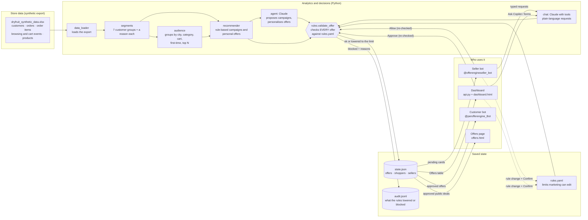

# Offer Copilot

An analytics and offer-decision system for an e-commerce store (here: *Nishtha's Pantry*, a dry-fruit shop with synthetic data). It works out which customer should get which offer and why, checks every offer against the store's rules in `rules.yaml`, and delivers offers to customers through Telegram. **AI proposes, rules decide, the seller has the final say.**

## Try it

| Bot | Link | For |
|---|---|---|
| **Customer bot** | [@perofferengine_Bot](https://t.me/perofferengine_Bot) | Shoppers. `/start` → choose *I'm new here* or *I've shopped before* → tap **🎁 My offer**, **🔥 Today's deals**, **👤 My profile** |
| **Seller bot** | [@offerengineseller_bot](https://t.me/offerengineseller_bot) | The shop owner / marketing. Unlock with `/seller <code>`, then `/campaigns`, Allow / Reject cards, or just type: *"What should I offer Amit Arora?"*, *"15% off almonds for lapsed customers in Ludhiana"*, *"Raise the Makhana limit to 18%"* |

## For evaluators

Demo access is switched on: send **/start** to the [seller bot](https://t.me/offerengineseller_bot) and it shows the seller code to copy; the dashboard login shows it too. (The owner turns this off afterwards with `DEMO_SHOW_SELLER_CODE=0` and changes the code.)

Suggested 3-minute tour:
1. [Customer bot](https://t.me/perofferengine_Bot): `/start` → *I've shopped before* → **🎁 My offer** (a personal, rule-checked offer, or a friendly "no discount" for top customers).
2. [Seller bot](https://t.me/offerengineseller_bot): `/start`, copy the `/seller …` line and send it, then `/campaigns` → press **✅ Allow** on a card for everyone: the offer arrives in the customer bot.
3. In the seller bot, type *"Make a Diwali deal: 25% off almonds for everyone"*: the rules lower it to the Nuts cap (12%) and say why. `/audit` shows every offer the rules lowered or blocked.

## Architecture



### The life of one offer

1. **Proposed** by the rule engine, by Claude, or by the seller (typed in a bot, asked in the dashboard chat, or built in the Create-an-offer form).
2. **Checked by `rules.validate_offer`** against `rules.yaml`: overall and category discount limits, minimum margin after discount for every product, minimum stock, marketing opt-out, cooldown and monthly cap per customer, first-order rules, dates. Result: **ok**, **lowered** to the highest allowed discount (the title, message and code are rewritten to the real number), or **blocked** with plain-English reasons. Lowered and blocked offers are written to the guardrail log.
3. **Pending**: shown to the seller as a card (seller bot) or a row (dashboard) with Allow / Reject.
4. **Allow / Approve**: checked **again** against the current rules (they may have changed), then **live**.
5. **Delivered** by the customer bot to every shopper it targets (everyone, a customer group, a hand-picked group, or one customer). Public deals also appear on the offers page.
6. **Used**: the shopper taps *Use this offer*; results show in `/stats`, `/audit` and the dashboard.

### Where the guardrails are

- **One place decides**: only `src/rules.py` enforces limits; no other module hardcodes a discount limit.
- **AI output is untrusted**: Claude's replies are structured (JSON schema) and every proposal still goes through the rules. Claude never publishes anything.
- **The seller has the final say**: nothing reaches customers without Allow / Approve; rule changes and taking an offer down need Confirm.
- **Private seller access**: the seller bot and dashboard need `SELLER_CODE`; wrong codes lock a chat for 10 minutes; secrets live only in `.env` (or the host's settings).

### Code map

| File | Job |
|---|---|
| `src/data_loader.py` | Loads the store export; `TODAY` for the simulation |
| `src/segments.py` | Sorts customers into 7 groups with a reason (thresholds at the top of the file) |
| `src/audience.py` | Picks groups of customers (city, category, cart, first-time, top N), leaving out opted-out and recently-offered ones |
| `src/recommender.py` | Rule-based campaigns and personal offers; runs every proposal through the rules |
| `src/agent.py` | Claude: campaign proposals, personal wording, the chat's single call |
| `src/chat.py` | Tools for plain-language seller requests (bot and dashboard) |
| `src/rules.py` | `validate_offer` and safe edits to `rules.yaml` |
| `src/store.py` | Offers, shoppers, sellers (`data/state.json`), guardrail log, offers-page export |
| `src/messages.py` | Telegram cards and customer messages |
| `src/bot.py` | Customer bot and seller bot |
| `src/dashboard.py` / `src/api.py` | Dashboard numbers and the dashboard's server and API |
| `src/serve.py` | Hosted start: dashboard + both bots in one process |
| `web/` | `dashboard.html` (sales team) and `offers.html` (store's public deals) |
| `tests/` | 58 tests: rules, bots, chat, dashboard API |

## Run the bot

Two Telegram bots, one program: a **customer bot** (classmates use it; this is the username to share and submit) and a **seller bot** (only you). Both read and write the same `data/state.json`, so an offer you Allow in the seller bot is sent to customers by the customer bot.

1. **Create the bots**: in Telegram open **@BotFather** → `/newbot` twice (e.g. `nishthas_pantry_bot` for customers, `nishthas_pantry_seller_bot` for you). Copy both tokens.
2. **Setup** (once, from the repo root):
   ```bash
   python3 -m venv .venv && .venv/bin/pip install -r requirements.txt
   cp .env.example .env
   ```
   Fill `.env`: `TELEGRAM_BOT_TOKEN` (customer bot), `SELLER_BOT_TOKEN` (seller bot), `SELLER_CODE` (a secret word), optionally `ANTHROPIC_API_KEY` for the AI agent. `.env` is git-ignored — never commit it. Leave `SELLER_BOT_TOKEN` empty to run a single bot that does both jobs.
3. **Start**: `.venv/bin/python -m src.bot` (keep it running; Ctrl+C stops both bots).

**Customer bot** — `/start` gives you a synthetic customer · `/profile` your orders, cart, points · `/offer` a personal offer chosen for you · `/offers` live deals.

**Seller bot** — private: nothing works until someone sends `/seller <SELLER_CODE>`. Give the code only to your team; anyone with it can unlock seller mode, nobody else can. The bot deletes the message with the code, locks a chat for 10 minutes after 5 wrong codes, and `/logout` removes access. Then `/campaigns` (proposes offers, each checked by `rules.yaml`, sent as cards with ✅ Allow / ❌ Reject) · `/pending` · `/live` · `/stats` · `/audit` (offers the rules lowered or blocked) · `/customer <name or id>`.

**Talk to the seller bot in plain English** (needs `ANTHROPIC_API_KEY`). Examples:
- "What should I offer Rohit?" → his profile and a suggested offer with Allow / Reject
- "Make a Diwali deal: 15% off almonds and cashews for everyone till 8 Nov" → a draft, rule-checked (Nuts are capped at 12%, so it is lowered and you are told why), with Allow / Reject
- "Can I give 25% on gift boxes?" → an answer from the rules
- "Raise the Makhana limit to 18%" → shows the change, updates `rules.yaml` only after you tap Confirm (unsafe values are refused)
- "Stop the Navratri deal" / "How are my offers doing?"

Nothing goes live from a chat message alone: drafts need Allow, rule changes and ending an offer need Confirm.

Allow re-checks the offer against the current `rules.yaml`, publishes it to `web/offers.json` and sends it, through the customer bot, to every customer it targets. You can use both bots from your own Telegram account to see both sides.

## Offers page

`web/offers.html` is the public storefront page. It shows every offer the seller has approved (from `web/offers.json`, written by the bot on Allow), with product prices before and after the discount, a copyable code and a countdown. It refreshes itself every minute.

```bash
python -m http.server -d web 8000
```
Open http://localhost:8000/offers.html. Before anything is approved, open http://localhost:8000/offers.html?sample to see it with example offers (`web/offers.sample.json`).

## Dashboard (for the sales and marketing team)

```bash
.venv/bin/python -m src.api
```
Open http://localhost:8000/dashboard.html and enter your `SELLER_CODE` (the same private code as the seller bot).

**Ask Copilot** (bottom-right, needs `ANTHROPIC_API_KEY`): chat with the assistant from the dashboard: "What should I offer Harpreet?", "15% off almonds for lapsed customers in Ludhiana", "Can I give 25% on gift boxes?", "Propose Diwali campaigns", "Raise the Makhana limit to 18%". Drafts appear as cards with Approve / Reject; rule changes and ending an offer ask you to Confirm. It remembers the last few messages, so "make it 10% instead" works. The same server also serves the store's offers page at /offers.html.

What the team can see: revenue and orders, customers going quiet and the spend at stake, open carts, the festival effect (Navratri, Rakhi, Diwali countdown), customer groups and what the engine does for each, category stock cover and discount limits, every offer and its status, the guardrail log, and the rules in force.

What the team can do:
- **Create an offer**: pick who (customer group, city, favourite category, first-time customers, open carts; the matching count updates live, with opted-out and recently-offered customers left out by the rules), products, discount and days. Or describe it in plain words ("12% off nuts for lapsed customers in Ludhiana") and Claude fills the form. **Check against rules** shows what would pass, be lowered or be blocked, and exactly what the customer will read.
- **Find a customer**: profile plus a suggested personal offer (or "no discount", e.g. for top customers).
- **Approve / Reject / End** offers. Approve re-checks the rules, then sends the offer through the customer bot to the customers it targets (group offers only reach their group).
- **Edit the rules**: change a number, press Save, read the change in words, Confirm. Unsafe values are refused.

Without the server (`python -m http.server -d web 8000`) the dashboard is read-only from `web/dashboard.json`, which the bot keeps up to date.

## Deploy (always on)

One container runs the dashboard and both bots: `python -m src.serve` (see `Dockerfile`). It listens on `$PORT` and serves `/dashboard.html`, `/offers.html` and `/healthz`.

**Render (free):** New → Web Service → connect this GitHub repo → Runtime: Docker → Instance: Free. Under **Environment** add `TELEGRAM_BOT_TOKEN`, `SELLER_BOT_TOKEN`, `SELLER_CODE`, `ANTHROPIC_API_KEY` (never commit them). Free services sleep after 15 minutes without visits, so add a free **UptimeRobot** HTTP monitor on `https://<your-app>.onrender.com/healthz` every 5 minutes.

**Important:** Telegram allows only one running copy of a bot. Stop the laptop bots (`Ctrl+C`) once the hosted copy is up, or set `RUN_BOTS=0` on the host to put only the dashboard online while the bots keep running on your laptop.

Free hosts have no permanent disk: offers made while hosted reset when the service restarts (the synthetic store data is in the image). For permanent storage, mount a disk and point `OFFER_STATE_FILE`, `OFFER_AUDIT_FILE`, `OFFER_PUBLIC_FILE` and `OFFER_DASHBOARD_FILE` at it.
